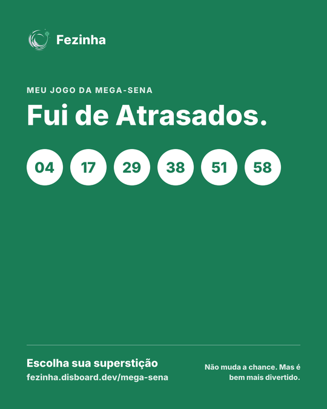
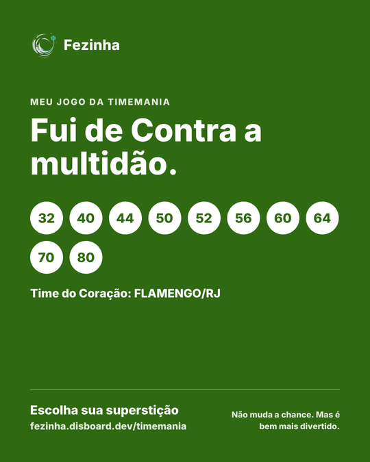

<div align="center">

<picture>
  <source media="(prefers-color-scheme: dark)" srcset="public/logo/logo.svg">
  
</picture>

# Fezinha

### Escolha sua superstição: a number generator for every Loterias CAIXA game, driven by the real draw history

**[fezinha.disboard.dev](https://fezinha.disboard.dev)** · Gerador de jogos da Mega-Sena e de todas as loterias da CAIXA · [Português ↓](#-em-português)

[](https://fezinha.disboard.dev)
[](https://nextjs.org)
[](https://react.dev)
[](https://tailwindcss.com)
[](https://loterias.caixa.gov.br)

<table>
  <tr>
    <td></td>
    <td></td>
  </tr>
</table>

</div>

## What it does

**Fezinha** ("fazer uma fezinha" is Brazilian for placing a small, hopeful bet) picks your lottery numbers the way
people actually pick them: by superstition. Choose a game, choose a belief, and it builds the game from the real
history of every draw since 1996, explaining each number it chose.

- **Every CAIXA game**: Mega-Sena, Lotofácil, Quina, Lotomania, Timemania, Dupla Sena, Dia de Sorte, Super Sete,
  +Milionária, Loteca and Federal, each on its own page and painted in its own colour.
- **The real values**: next draw and date, estimated prize, accumulated amount, the special draws (Mega da Virada,
  Quina de São João, Lotofácil da Independência, Dupla de Páscoa) and the last result with its full prize table.
- **Twelve superstitions**, plus four for the Loteca:

  | Superstition | How it picks |
  |---|---|
  | Surpresinha | Pure chance, like the button at the lottery shop |
  | Quentes / Frios | The numbers drawn most / least in the last 100, 500 or all draws |
  | Atrasados | The ones that haven't come up for the longest ("tão devendo") |
  | Repeteco | The last result again |
  | Fugitivos | Only numbers absent from the last 10 draws |
  | Contra a multidão | What the crowd avoids: above 31, even, round, on the edge of the slip |
  | Equilibrado | Half even, half odd, one per band of the slip |
  | Datas especiais | Days, months, years and sums from your dates |
  | Numerologia | Your name through the Pythagorean table |
  | Sonhei com… | The jogo do bicho dream table: dreamt of a snake, play 33 to 36 |
  | Inédito | A game that never came up in the whole history |

- **Every number explained**: "saiu 17× em 100 sorteios", "41 sorteios sem sair", "grupo 09 · Cobra".
- **The betting slip shows the logic**: a heat map for hot and cold numbers, the recent ones crossed out, the
  birthday zone greyed for *Contra a multidão*.
- **Honest about the odds**: every game says what the superstition does to your chances, which is nothing.
  *Contra a multidão* is the one with research behind it: it can't make you win, but if you do, you share the prize
  with fewer people ([Wang et al. 2016](https://dlab.sauder.ubc.ca/sjdm/journal/15/151103a/jdm151103a.html),
  Henze 1997, Simon 1998).
- **Meus jogos**: save a game and it is checked by itself against the result of its own draw, with the prize worked
  out from CAIXA's prize table, including trevos, Time do Coração, Mês de Sorte and both Dupla Sena draws.
- **Share card**: a 1080×1350 image of your game, sent through the phone's share sheet.
- **Ganhou? Paga um café**: if a game from here wins, a Pix QR code with the amount of each tier.

## 🇧🇷 Em português

**Gerador de jogos para todas as loterias da CAIXA**, escolhido pela sua superstição: números quentes, frios,
atrasados, o último resultado, datas especiais, numerologia, a tabela do bicho ou a única com pesquisa por trás,
*Contra a multidão*. Cada número vem com o motivo, o volante mostra a lógica, e cada página traz o resultado, o
prêmio estimado e a data do próximo concurso direto da CAIXA. Salve seus jogos e eles são conferidos sozinhos depois
do sorteio. Nenhuma superstição muda suas chances, mas todas deixam o jogo mais divertido.

Acesse: **[fezinha.disboard.dev](https://fezinha.disboard.dev)**

## How it works

| Piece | Where |
|---|---|
| Latest result and prizes | The CAIXA API, `servicebus2.caixa.gov.br/portaldeloterias/api/<jogo>[/<concurso>]` |
| Full draw history | [loteriascaixa-api](https://loteriascaixa-api.herokuapp.com/api), one request per game |
| Games table (ranges, colours, odds, extras) | `src/core/models/lottery.ts` |
| The superstitions, one table with each one's picker | `src/utils/superstitions.ts` |
| Checking a saved game against its draw | `src/core/models/saved_game.ts`, through `/api/resultado/<jogo>/<concurso>` |
| Pix QR code (static BR Code with a CRC16) | `src/utils/pix.ts` |
| Share card (`next/og`) | `src/app/[jogo]/cartao/route.tsx` |

- Every game page is prerendered at build and refreshed every 10 minutes. The history runs to 6 MB per game, over
  Next's 2 MB fetch-cache limit, so it is trimmed to the drawn numbers and cached for an hour.
- Picks use a seeded random generator, so a render is pure and the server and the browser agree.
- A game's colour reaches the whole page through `data-game` and two CSS variables; there is no per-game styling.
- Saved games live in the browser's `localStorage` (Zustand). Nothing is stored on a server.

## Running locally

```bash
npm install
cp .env.example .env
npm run dev
```

`.env` holds only `NEXT_PUBLIC_*` values (the Pix key, name and city, and an optional Buy Me a Coffee link). Without
them the café page says Pix is not set up yet.

The logo is generated, not drawn: `node scripts/make_logo.mjs public/logo` rebuilds every variant.

## Deploying

Docker on the disboard.dev VPS, behind Nginx Proxy Manager, from a clone of this repository:

```bash
ssh contabo 'cd /var/www/docker/fezinha && git pull && docker compose build && docker compose up -d'
```

The server's `.env` is not in git; `NEXT_PUBLIC_*` values are baked in at build, so a change to them needs the build.

## Project layout

```
src/
  app/
    [jogo]/          one page per game: layout (title, game strip), loading skeleton, page, cartao/ (share card)
    api/resultado/   a single draw's result, for Meus jogos
    supersticoes/  jogos/  meus-jogos/  cafe/
  core/
    models/          lottery.ts (games, CAIXA and history shapes), saved_game.ts (checking a game)
    controllers/     saved_games_controller.ts (localStorage)
  components/        nav_bar, footer, section_header, empty_state
  services/          loterias.ts (CAIXA and history fetches)
  utils/             superstitions, pix, format, game_style
  styles/            tokens.css, theme.css, base.css, utilities.css
public/logo/         the mark in dark and light, the favicon
scripts/             make_logo.mjs
```

## Disclaimer

Fezinha is an independent site, not affiliated with CAIXA. It does not sell bets: play only through the official
channels. No superstition changes your chances. Lotteries are for adults only, so play responsibly.
